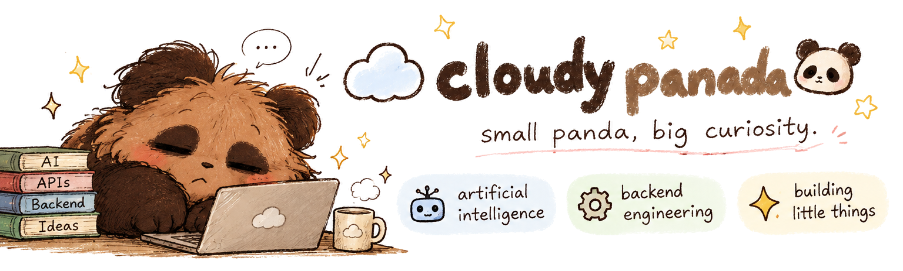
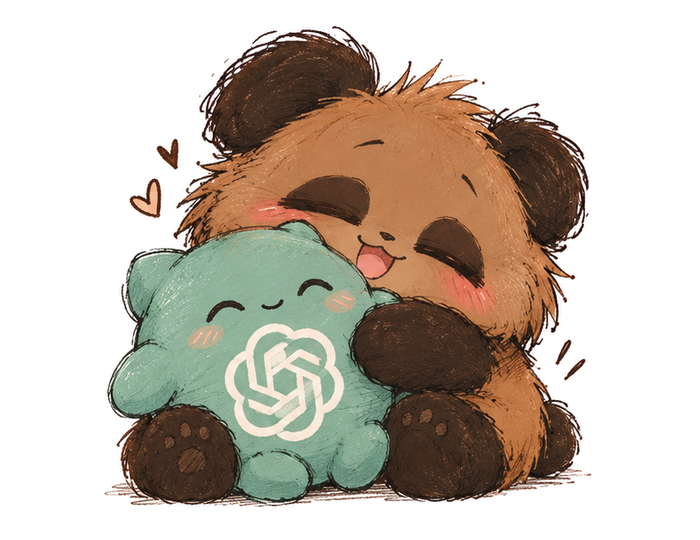
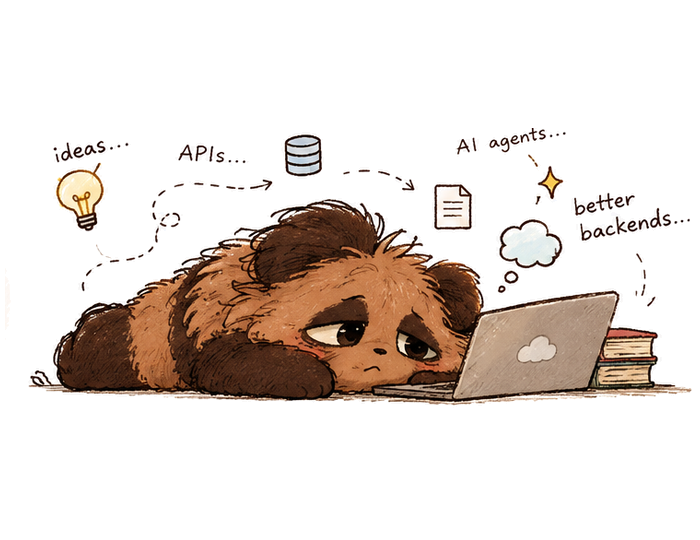
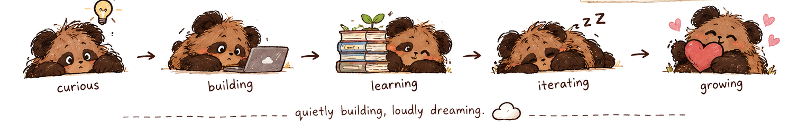

  

  ☁️ tiny paws, big ideas · made of curiosity and a little too much tea 🍵

  
  &nbsp;
  

  <b>🤖 ai things</b> &nbsp;·&nbsp; <b>⚙️ backend things</b> &nbsp;·&nbsp; <b>✨ tiny experiments</b>

🍵 currently brewing...
- 🤖 AI agents & LLMs — teaching computers some new tricks
- ⚙️ APIs & backend systems — making the invisible stuff work nicely
- 🧩 Little experiments — turning what if? into it works!
- 🌱 Learning — one curious rabbit hole at a time

  
   
  cloudy.exe has four moods: 🍵 😱 🫠 🤨

  
   
  <b><i>quietly building, loudly dreaming. ☁️</i></b>

